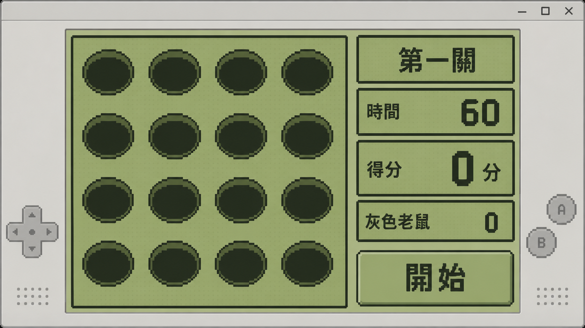
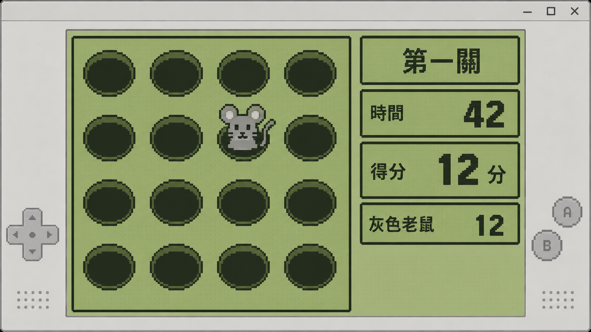
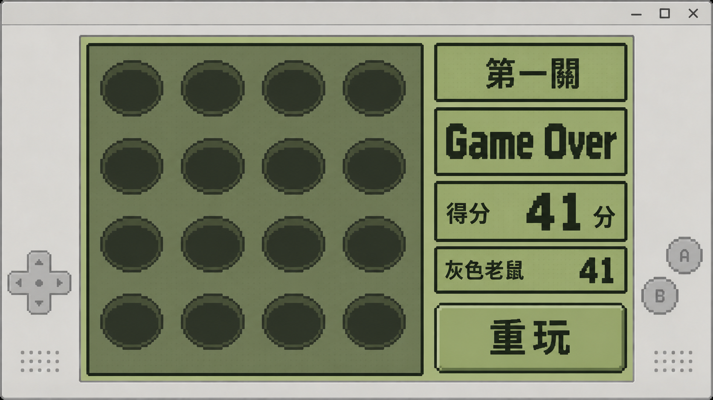
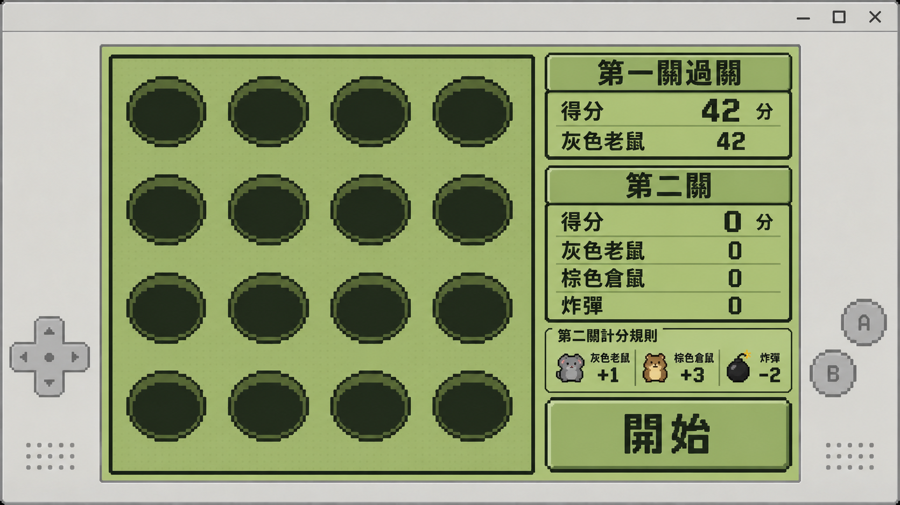
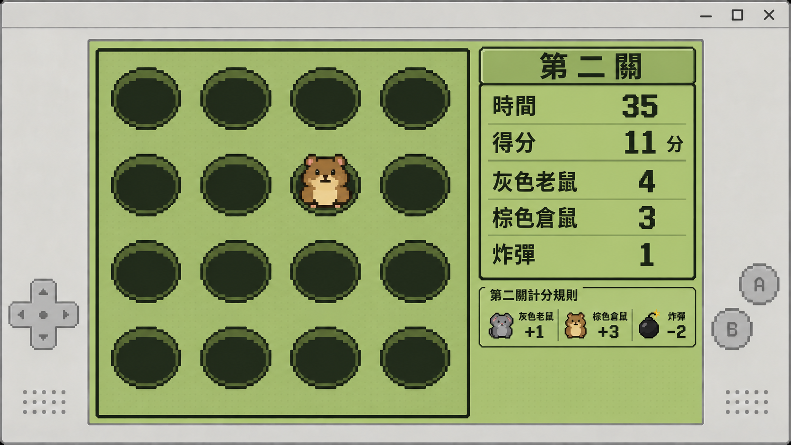
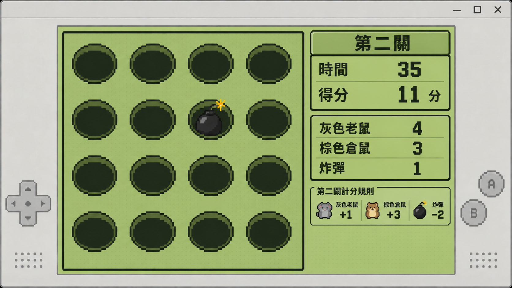
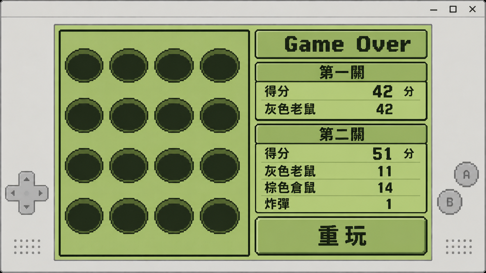
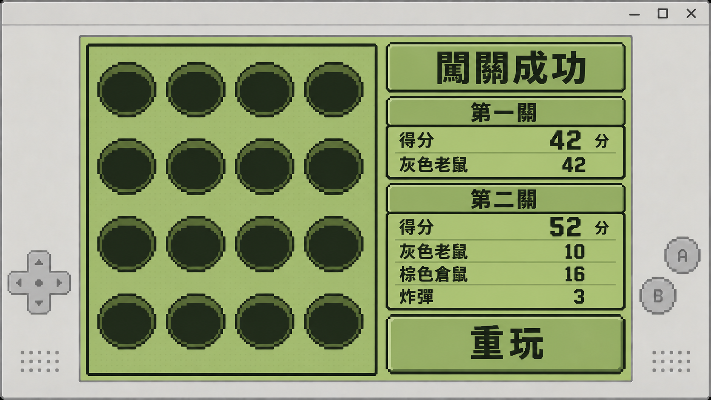

# 打地鼠遊戲 UI 規格

## 文件定位

本文件依 [use_case.md](use_case.md) 記錄已確認的 Game Boy 遊戲機風格 WinForms 畫面。玩家流程、計分及關卡結果以 `use_case.md` 為準；本文件規範排版、圖案、可點擊範圍與畫面參考。下方八張預覽圖已由使用者確認，作為新版介面的視覺與資訊配置依據。預覽中的分數、時間及命中數是示例，實際畫面須顯示當局資料。

## 共通畫面

- 以可實作的桌面 WinForms 視窗呈現掌機風格：灰色機殼、橄欖綠像素螢幕、深色像素邊框與字體。機殼上的方向鍵、A／B 圖樣只作裝飾，不是遊戲操作入口。
- 4×4 的 16 個洞口固定在主要遊戲區，依列、行對齊，全部保持可辨識。遊玩時棋盤較大，倒數與當關記分板位於旁側；結算時棋盤可縮小以增加成績區，但仍完整顯示 16 個空洞。
- 洞口目標以像素圖案呈現：灰色老鼠保留低飽和灰色，棕色倉鼠保留低飽和棕色，炸彈為深色圖案。圖案的外形也須能區分目標，不依賴顏色作唯一辨識方式。
- 目標圖案上不顯示「灰色老鼠」、「棕色倉鼠」或「炸彈」文字。記分板、第二關得扣分提示與成績卡可使用這些名稱。
- 第一關待開始、遊玩及失敗時不顯示第二關得扣分提示。提示在第一關過關／第二關待開始的合併畫面出現，第二關遊玩期間保留，第二關結束時隱藏。
- 開始或重玩按鈕只在對應待開始或結算階段出現。遊玩中的洞口是玩家點擊目標的區域，裝飾性機殼按鍵不執行開始、重玩或命中。

## 目標點擊與結束畫面

- 只有滑鼠點在畫面上當下有效目標圖案的可見輪廓內才算命中；有效區域以目標本體實際顯示的不透明圖形為準，不以整個洞口或圖案的外接矩形代替。
- 點擊洞口背景、圖案透明處、沒有目標的洞口或已失效的舊圖案，不增加分數或命中／點中數量，也不使仍有效的目標提前消失。關卡時間仍依遊戲規則正常推進。
- 關卡結束後清除所有目標，保留空的 4×4 棋盤；洞口此時不可命中。第一關結束顯示一張第一關成績卡，第二關結束顯示分開的第一關及第二關成績卡。
- 第一關過關與第二關待開始是同一畫面：保留第一關過關標語及成績卡，同時顯示第二關歸零記分板、得扣分提示與「開始」按鈕，不增加額外的繼續操作。

## 八個已確認情境

| 情境 | 洞口與右側資訊 | 操作按鈕 |
| --- | --- | --- |
| 第一關待開始 | 16 個空洞；第一關分數與灰色老鼠數量皆為 0；不顯示第二關提示。 | 開始 |
| 第一關遊玩 | 16 個洞口中最多一個有效灰色老鼠圖案；顯示倒數、第一關分數與灰色老鼠命中數。 | 無 |
| 第一關失敗 | 16 個空洞不可命中；單張成績卡顯示第一關分數與灰色老鼠命中數，以及 `Game Over`。 | 重玩 |
| 第一關過關／第二關待開始 | 16 個空洞不可命中；第一關過關標語及成績卡、第二關歸零記分板和灰鼠 +1／倉鼠 +3／炸彈 −2 的提示同時可見。 | 開始 |
| 第二關遊玩：倉鼠 | 16 個洞口中最多一個有效棕色倉鼠圖案；顯示倒數、第二關分數、三種目標的數量及得扣分提示。 | 無 |
| 第二關遊玩：炸彈 | 同一遊玩排版，唯一有效目標改為炸彈圖案。 | 無 |
| 第二關失敗 | 16 個空洞不可命中；兩張成績卡分別顯示兩關分數與各自紀錄，以及 `Game Over`；不顯示得扣分提示。 | 重玩 |
| 第二關成功 | 與第二關失敗相同的兩張成績卡排版，標語改為「闖關成功」。 | 重玩 |

## 畫面預覽

### 第一關待開始

### 第一關遊玩

### 第一關失敗

### 第一關過關／第二關待開始

### 第二關遊玩：棕色倉鼠

### 第二關遊玩：炸彈

### 第二關失敗

### 第二關成功

## 預覽數字的用途

第一關失敗圖的 41 分及過關圖的 42 分用來顯示兩種門檻結果；第二關失敗圖的 51 分與成功圖的 52 分亦然。第二關失敗示例為灰鼠 11、倉鼠 14、炸彈 1，得分 `11 + 14×3 − 1×2 = 51`；成功示例為灰鼠 10、倉鼠 16、炸彈 3，得分 `10 + 16×3 − 3×2 = 52`。這些數字只是版面示例，不限制玩家實際結果。
